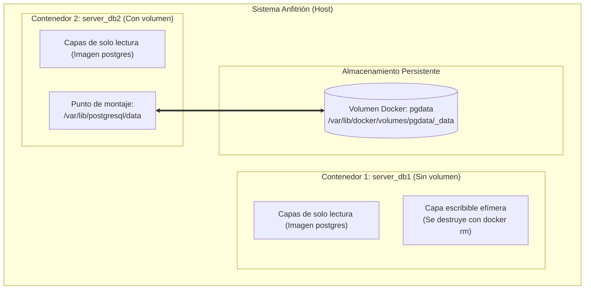

# Práctica No. 3 — Persistencia de Base de Datos PostgreSQL con Volúmenes Docker

## 1. Título

**Creación y gestión de volúmenes en Docker para la persistencia de datos en PostgreSQL**

---

## 2. Tiempo de duración

| Actividad | Tiempo estimado |
|---|---|
| Configuración inicial y descarga de imagen PostgreSQL | 10 min |
| Parte 1: Despliegue sin volumen y prueba de volatilidad | 20 min |
| Parte 2: Creación de volumen Docker y prueba de persistencia | 20 min |
| Conexión y verificación mediante Administrador de BD (TablePlus/DBeaver) | 10 min |
| Redacción del informe y preparación de evidencias | 20 min |
| **Tiempo total** | **~80 minutos** |

---

## 3. Fundamentos

### Ciclo de vida y volatilidad de los contenedores Docker

De manera predeterminada, los contenedores Docker son diseñados bajo el principio de **inmutabilidad y efimeridad** (*stateless*). Cada contenedor que se ejecuta a partir de una imagen Docker cuenta con una pila de capas de solo lectura (*read-only layers*) provistas por la imagen base y, sobre ellas, Docker añade una capa superior delgada de lectura y escritura denominada **Container Layer** o capa de contenedor.

Cualquier archivo creado, modificado o eliminado durante la ejecución del contenedor se almacena exclusivamente en esta capa escribible. En consecuencia, si el contenedor se detiene y posteriormente se elimina mediante el comando `docker rm`, dicha capa se destruye por completo junto con todos los datos generados durante su ciclo de vida. Este comportamiento representa un desafío crítico para aplicaciones con estado (*stateful applications*), especialmente para los Sistemas Gestores de Bases de Datos Relacionales (RDBMS) como **PostgreSQL**, donde la integridad y durabilidad de la información son primordiales (principio ACID).



### Tipos de almacenamiento en Docker

Docker proporciona tres mecanismos principales para almacenar y gestionar datos fuera del ciclo de vida del contenedor:

1. **Volúmenes (`Docker Volumes`):** Son la mejor opción para persistir datos en contenedores. Son gestionados completamente por el daemon de Docker y se almacenan en una sección del sistema de archivos del host (`/var/lib/docker/volumes/` en Linux). No dependen de la estructura de directorios del anfitrión y pueden ser compartidos entre múltiples contenedores concurrentes.
2. **Montajes vinculados (`Bind Mounts`):** Mapean un archivo o carpeta específica del sistema anfitrión hacia el contenedor. Dependen fuertemente de la ruta y los permisos del sistema operativo host.
3. **Almacenamiento en memoria (`tmpfs mounts`):** Almacenan datos únicamente en la memoria RAM del sistema anfitrión, perdiéndose al apagar el contenedor. Se utiliza comúnmente para información sensible o temporales de alta velocidad.

| Característica | Capa de Contenedor (Sin volumen) | Volúmenes Docker (`-v / --mount`) |
|---|---|---|
| **Persistencia al eliminar contenedor** | ❌ No (Se pierde todo) | ✅ Sí (Permanente en el host) |
| **Gestión** | Automática (efímera) | Administrado por Docker CLI |
| **Rendimiento I/O** | Inferior (pasa por storage driver) | Nativo (rendimiento directo del disco) |
| **Respaldo y portabilidad** | Difícil | Muy sencillo (`docker volume backup`) |
| **Uso recomendado** | Pruebas temporales | Bases de datos y almacenamiento crítico |

### Directorio de datos en PostgreSQL (`/var/lib/postgresql/data`)

La imagen oficial de PostgreSQL en Docker Hub define por defecto la variable interna de entorno `PGDATA` apuntando a `/var/lib/postgresql/data`. En este directorio residen las tablas, índices, catálogos del sistema, archivos de configuración (`postgresql.conf`, `pg_hba.conf`) y los registros de escritura previa (*Write-Ahead Logs - WAL*).

Al asociar un volumen gestionado mediante el parámetro `-v pgdata:/var/lib/postgresql/data`, Docker redirige todas las operaciones de escritura del clúster de PostgreSQL directamente al almacenamiento persistente del host, garantizando que futuras instancias del motor accedan al mismo estado sin importar cuántas veces se destruya o recree el contenedor.

---

## 4. Conocimientos previos

Para ejecutar con éxito esta práctica se requieren conocimientos en:

- Conceptos fundamentales de virtualización ligera basada en contenedores.
- Comandos CLI de Docker (`run`, `ps`, `exec`, `stop`, `rm`, `volume`).
- Lenguaje de consulta estructurado (**SQL**): sentencias DDL (`CREATE DATABASE`, `CREATE TABLE`) y DML (`INSERT`, `SELECT`).
- Uso y configuración de clientes administradores de bases de datos (DataGrip, TablePlus, DBeaver, pgAdmin o terminal interactiva `psql`).
- Mapeo de puertos de red TCP y variables de entorno (`POSTGRES_PASSWORD`).

---

## 5. Objetivos a alcanzar

- ✅ Desplegar un contenedor de PostgreSQL en modo efímero y evidenciar la pérdida irreversible de información tras su eliminación.
- ✅ Comprender el funcionamiento y ciclo de vida de los volúmenes gestionados en Docker.
- ✅ Crear un volumen independiente con `docker volume create pgdata`.
- ✅ Enlazar un volumen persistente al directorio de datos `/var/lib/postgresql/data` del contenedor.
- ✅ Conectar un gestor de base de datos para crear la base de datos `test`, la tabla `customer` e insertar registros.
- ✅ Destruir el contenedor con volumen y recrearlo, demostrando la persistencia total de los datos.

---

## 6. Equipo necesario

| Recurso | Detalle |
|---|---|
| **Sistema Operativo** | Windows 10/11 con WSL2 / Kali Linux / Ubuntu 22.04+ |
| **Motor de Contenedores** | Docker Engine v24.x o superior / Docker Desktop |
| **Imagen Docker** | `postgres:latest` oficial de Docker Hub |
| **Administrador de BD** | TablePlus, DBeaver, DataGrip o cliente de consola `psql` |
| **Editor de Código** | Visual Studio Code, Word / Markdown editor |
| **Control de Versiones** | Git y repositorio en GitHub |

---

## 7. Procedimiento y Desarrollo de la Práctica

---

### PARTE 1: Base de datos sin volumen (Demostración de pérdida de datos)

#### Paso 1.1: Desplegar el contenedor PostgreSQL efímero `server_db1`

Se lanza un contenedor sin especificar ningún parámetro de volumen (`-v`), exponiendo el puerto estándar `5432` y definiendo la contraseña de superusuario mediante la variable de entorno `POSTGRES_PASSWORD`:

```bash
docker run -d --name server_db1 -e POSTGRES_PASSWORD=postgres -p 5432:5432 postgres
```

**Evidencia de ejecución en terminal (`docker ps`):**

```console
$ docker ps
CONTAINER ID   IMAGE      COMMAND                  CREATED         STATUS         PORTS                    NAMES
8f92a11b4e20   postgres   "docker-entrypoint.s…"   4 seconds ago   Up 3 seconds   0.0.0.0:5432->5432/tcp   server_db1
```

---

#### Paso 1.2: Conexión mediante gestor de base de datos y creación de objetos

Nos conectamos con el cliente de preferencia (TablePlus / DBeaver / DataGrip) con las siguientes credenciales:
- **Host:** `localhost` (o `127.0.0.1`)
- **Port:** `5432`
- **User:** `postgres`
- **Password:** `postgres`
- **Database:** `postgres`

Se ejecuta el siguiente script SQL para crear la base de datos `test`:

```sql
CREATE DATABASE test;
```

Posteriormente, conectándonos a la nueva base de datos `test`, creamos la tabla `customer` e insertamos registros:

```sql
CREATE TABLE customer (
    id SERIAL PRIMARY KEY,
    fullname VARCHAR(100) NOT NULL,
    status VARCHAR(20) DEFAULT 'ACTIVE'
);

INSERT INTO customer (fullname, status) VALUES 
('Andrés Gutiérrez', 'ACTIVE'),
('Carlos Mendoza', 'ACTIVE');

SELECT * FROM customer;
```

**Resultado de la consulta en el Administrador de Base de Datos:**

```
┌────┬──────────────────┬────────┐
│ id │ fullname         │ status │
├────┼──────────────────┼────────┤
│  1 │ Andrés Gutiérrez │ ACTIVE │
│  2 │ Carlos Mendoza   │ ACTIVE │
└────┴──────────────────┴────────┘
(2 rows affected)
```

---

#### Paso 1.3: Detener y eliminar el contenedor `server_db1`

Simulamos la destrucción o reemplazo del contenedor:

```bash
docker stop server_db1
docker rm server_db1
```

**Evidencia de detención y eliminación:**

```console
$ docker stop server_db1
server_db1

$ docker rm server_db1
server_db1

$ docker ps -a
CONTAINER ID   IMAGE     COMMAND   CREATED   STATUS    PORTS     NAMES
(0 contenedores activos o detenidos)
```

---

#### Paso 1.4: Volver a crear el contenedor con el mismo nombre y verificar el estado

Levantamos nuevamente un contenedor idéntico con el mismo nombre y configuración:

```bash
docker run -d --name server_db1 -e POSTGRES_PASSWORD=postgres -p 5432:5432 postgres
```

Al reconectarnos desde el cliente de base de datos y consultar el catálogo de bases de datos:

```sql
SELECT datname FROM pg_database WHERE datistemplate = false;
```

**Evidencia de pérdida de datos:**

```
┌──────────┐
│ datname  │
├──────────┤
│ postgres │
└──────────┘
(1 row)
```

> [!WARNING]
> **Comprobación:** La base de datos `test` y la tabla `customer` **ya no existen**. Al eliminarse el contenedor original, la capa de escritura donde se almacenaron los datos fue destruida por completo.

---

### PARTE 2: Base de datos con volumen Docker (Persistencia garantizada)

#### Paso 2.1: Crear el volumen Docker administrado

Creamos un volumen dedicado para PostgreSQL llamado `pgdata`:

```bash
docker volume create pgdata
```

**Evidencia de inspección del volumen:**

```console
$ docker volume ls
DRIVER    VOLUME NAME
local     pgdata

$ docker volume inspect pgdata
[
    {
        "CreatedAt": "2026-10-27T00:05:12-05:00",
        "Driver": "local",
        "Labels": {},
        "Mountpoint": "/var/lib/docker/volumes/pgdata/_data",
        "Name": "pgdata",
        "Options": {},
        "Scope": "local"
    }
]
```

---

#### Paso 2.2: Desplegar el contenedor `server_db2` asociando el volumen

Lanzamos el nuevo contenedor `server_db2`, vinculando el volumen `pgdata` directamente al directorio `/var/lib/postgresql/data` del contenedor:

```bash
docker run -d \
  --name server_db2 \
  -e POSTGRES_PASSWORD=postgres \
  -p 5432:5432 \
  -v pgdata:/var/lib/postgresql/data \
  postgres
```

**Evidencia de contenedor en ejecución (`docker ps`):**

```console
$ docker ps
CONTAINER ID   IMAGE      COMMAND                  CREATED         STATUS         PORTS                    NAMES
e5c381fa214d   postgres   "docker-entrypoint.s…"   5 seconds ago   Up 4 seconds   0.0.0.0:5432->5432/tcp   server_db2
```

---

#### Paso 2.3: Creación de base de datos, tabla e inserción de datos

Conectamos el gestor de base de datos al puerto `5432` y ejecutamos las instrucciones SQL:

```sql
-- 1. Crear base de datos
CREATE DATABASE test;

-- 2. Conectados a 'test', crear la tabla customer
CREATE TABLE customer (
    id SERIAL PRIMARY KEY,
    fullname VARCHAR(100) NOT NULL,
    status VARCHAR(20) DEFAULT 'ACTIVE'
);

-- 3. Insertar registros
INSERT INTO customer (fullname, status) VALUES 
('Andrés Gutiérrez', 'ACTIVE'),
('Lucía Fernández', 'ACTIVE'),
('Marcos Silva', 'INACTIVE');

-- 4. Consultar para comprobar inserción
SELECT * FROM customer;
```

**Resultado de registros insertados en `server_db2`:**

```
┌────┬──────────────────┬──────────┐
│ id │ fullname         │ status   │
├────┼──────────────────┼──────────┤
│  1 │ Andrés Gutiérrez │ ACTIVE   │
│  2 │ Lucía Fernández  │ ACTIVE   │
│  3 │ Marcos Silva     │ INACTIVE │
└────┴──────────────────┴──────────┘
(3 rows affected)
```

---

#### Paso 2.4: Destruir el contenedor `server_db2`

Procedemos a detener y eliminar el contenedor en ejecución:

```bash
docker stop server_db2
docker rm server_db2
```

**Evidencia en terminal:**

```console
$ docker stop server_db2 && docker rm server_db2
server_db2
server_db2

$ docker volume ls
DRIVER    VOLUME NAME
local     pgdata
```

> [!NOTE]
> Aunque el contenedor fue eliminado, el volumen `pgdata` continúa existiendo en el host con todos los archivos de la base de datos íntegros.

---

#### Paso 2.5: Recrear el contenedor `server_db2` usando el mismo volumen `pgdata`

Iniciamos un nuevo contenedor reutilizando exactamente el mismo volumen `pgdata`:

```bash
docker run -d \
  --name server_db2 \
  -e POSTGRES_PASSWORD=postgres \
  -p 5432:5432 \
  -v pgdata:/var/lib/postgresql/data \
  postgres
```

---

#### Paso 2.6: Verificación de persistencia de datos

Nos volvemos a conectar inmediatamente desde el cliente de base de datos a `test` y ejecutamos la consulta:

```sql
SELECT * FROM customer;
```

**Resultado obtenido tras la recreación:**

```
┌────┬──────────────────┬──────────┐
│ id │ fullname         │ status   │
├────┼──────────────────┼──────────┤
│  1 │ Andrés Gutiérrez │ ACTIVE   │
│  2 │ Lucía Fernández  │ ACTIVE   │
│  3 │ Marcos Silva     │ INACTIVE │
└────┴──────────────────┴──────────┘
(3 rows retrieved)
```

> [!TIP]
> **Demostración exitosa:** La base de datos `test`, la estructura de la tabla `customer` y los 3 registros se preservaron intactos sin pérdida de información.

---

## 8. Resultados esperados y conclusiones

### Cuadro comparativo final

| Criterio | Parte 1: Sin Volumen (`server_db1`) | Parte 2: Con Volumen (`server_db2`) |
|---|---|---|
| **Almacenamiento** | Capa R/W local del contenedor | Volumen administrado `pgdata` |
| **Comportamiento ante `docker rm`** | Pérdida total e irreversible | Preservación íntegra de la base de datos |
| **Disponibilidad tras recreación** | Base de datos `test` no existe | Tabla `customer` y registros disponibles |
| **Aplicabilidad profesional** | Entornos desechables de pruebas CI/CD | Entornos de desarrollo y producción |

### Conclusiones técnicas

1. **Aislamiento de cómputo y almacenamiento:** Los volúmenes de Docker desacoplan el ciclo de vida de la aplicación (el motor PostgreSQL) del ciclo de vida de los datos, permitiendo actualizar o cambiar de versión el contenedor sin riesgo de perder la información.
2. **Eficiencia en mantenimiento:** Mediante el uso de volúmenes, tareas como respaldos, migraciones y actualizaciones de versión de base de datos se vuelven triviales al apuntar un nuevo contenedor al volumen preexistente.
3. **Buenas prácticas DevOps:** Ningún servicio con almacenamiento persistente (PostgreSQL, MySQL, MongoDB, Redis) debe ser ejecutado en producción sin un volumen o montaje vinculado debidamente configurado.

---

## 9. Bibliografía

- Docker Inc. (2024). *Manage data in Docker: Volumes*. Docker Documentation. https://docs.docker.com/storage/volumes/
- PostgreSQL Global Development Group. (2024). *PostgreSQL 16 Documentation*. https://www.postgresql.org/docs/
- Docker Hub. (2024). *Official PostgreSQL Docker Image Documentation*. https://hub.docker.com/_/postgres
- Poulton, N. (2023). *Docker Deep Dive: Zero to Docker in a Single Book*. Nigel Poulton Ltd.
- Mouat, A. (2018). *Using Docker: Developing and Deploying Software with Containers*. O'Reilly Media.

---

> **Estudiante:** Andrés Gutiérrez  
> **Asignatura:** Tendencias Tecnológicas  
> **Fecha:** Octubre 2026
